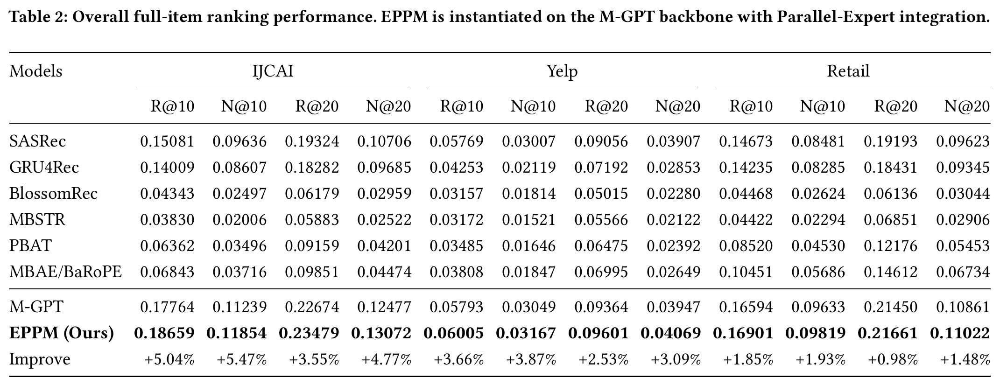

# Explicit Post-Action Preference Modeling for Strict Next-Interaction Recommendation

EPPM separates historical preference encoding from latest-anchor incorporation
to construct an explicit post-action prediction state. This repository provides
the M-GPT implementation for the EPPM results on IJCAI, Yelp, and Retail.


## Contents

- [Usage](#usage)
- [Results](#results)
- [Acknowledgement](#acknowledgement)

## Usage

### Requirements

- Python 3.8
- PyTorch 2.0.0 / CUDA 11.8
- PyTorch Lightning 1.9.5

```bash
conda env create -f environment.yml
conda activate eppm
```

### Data

Place the processed datasets under:

```text
data/canonical/
  ijcai/dataset.pkl
  yelp/dataset.pkl
  retail/dataset.pkl
```

Upstream data downloads:

- **IJCAI:** [Tianchi](https://tianchi.aliyun.com/dataset/42).
- **Yelp:** [KHGT data](https://github.com/akaxlh/KHGT/tree/master/Datasets/Yelp).
- **Retail:** [PBAT download](https://drive.google.com/file/d/1Ki8ibuTgkxnBITCe4gNLtrR0mG1vxevl/view?usp=sharing).

### Train and Evaluate

Each command trains EPPM and tests the validation-best checkpoint:

```bash
python src/main.py --dataset ijcai --gpu 0
python src/main.py --dataset yelp --gpu 0
python src/main.py --dataset retail --gpu 0
```

Resume training or evaluate a saved model:

```bash
python src/main.py --dataset yelp --gpu 0 --resume
python src/main.py --dataset yelp --gpu 0 --mode test
```

Configurations are in `configs/`. Outputs are saved to
`outputs/<dataset>/seed2025/`. See [reproduction details](docs/REPRODUCIBILITY.md).

## Results

Table 2. Overall full-item ranking performance.



## Acknowledgement

Our implementation builds on M-GPT, *Multi-Grained Preference Enhanced
Transformer for Multi-behavior Sequential Recommendation*.
See [source notices](THIRD_PARTY_NOTICES.md).
