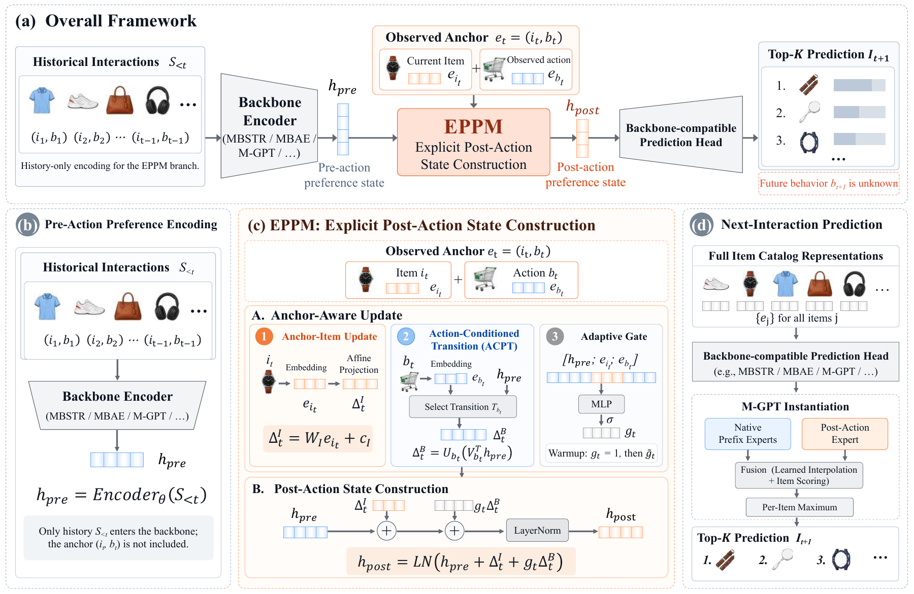

# Explicit Post-Action Preference Modeling for Strict Next-Interaction Recommendation

EPPM separates history-derived preference encoding from incorporation of the
latest observed item-action pair. This repository contains the M-GPT
Parallel-Expert implementation used for the **EPPM row of Table 2** on IJCAI,
Yelp, and Retail. Baselines, transfer-backbone experiments, and ablations are
not included.

All data splits use one shared anchor-inclusive window of at most 50 events.
The history-only branch receives its preceding at most 49 events; the anchor
is supplied separately. This corrects the independently truncated evaluation
views in the original implementation without changing training examples.



## Contents

- [Requirements](#requirements)
- [Data](#data)
- [Usage](#usage)
- [Results](#results)
- [Repository Structure](#repository-structure)
- [Acknowledgement](#acknowledgement)

## Requirements

The primary experiments used Linux, Python 3.8.20, PyTorch 2.0.0 with CUDA 11.8,
PyTorch Lightning 1.9.5, and NVIDIA RTX 3090 GPUs.

```bash
conda env create -f environment.yml
conda activate eppm
```

Alternatively, install PyTorch first and then the remaining dependencies:

```bash
pip install torch==2.0.0 --index-url https://download.pytorch.org/whl/cu118
pip install -r requirements.txt
```

## Data

Training requires the frozen datasets used in Table 2. Their format and
SHA256 checksums are documented in [data/README.md](data/README.md).
Datasets and checkpoints are not included in the Git repository. A public
download link for the frozen data is not yet available.

If you have obtained `EPPM_datasets.zip`, extract it into the repository root:

On Linux:

```bash
unzip /path/to/EPPM_datasets.zip -d .
```

On Windows PowerShell:

```powershell
Expand-Archive -LiteralPath ..\EPPM_datasets.zip -DestinationPath .
```

For datasets obtained separately, the following commands verify and install
each frozen artifact. They also verify an artifact already at its target path:

```bash
python scripts/prepare_data.py --dataset ijcai --source /path/to/ijcai/dataset.pkl
python scripts/prepare_data.py --dataset yelp --source /path/to/yelp/dataset.pkl
python scripts/prepare_data.py --dataset retail --source /path/to/retail/dataset.pkl
```

The resulting layout is:

```text
data/canonical/
  ijcai/dataset.pkl
  yelp/dataset.pkl
  retail/dataset.pkl
```

## Usage

Train EPPM and evaluate the validation-best checkpoint:

```bash
python src/main.py --dataset ijcai --gpu 0
python src/main.py --dataset yelp --gpu 0
python src/main.py --dataset retail --gpu 0
```

Run these commands separately or assign them to different available GPUs.
The configuration files preserve the primary seed, sampling budget, optimizer,
warmup schedule, validation cadence, and stopping rules.

| Setting | IJCAI | Yelp | Retail |
|---|---:|---:|---:|
| Seed / sampler seed | 2025 | 2025 | 2025 |
| Microbatch | 256 | 512 | 512 |
| Gradient accumulation | 2 | 1 | 1 |
| Optimizer updates per epoch | 600 | 600 | 600 |
| Validation interval, epochs | 2 | 1 | 1 |
| Early-stopping patience, validation checks | 10 | 10 | 10 |
| Maximum epochs | 300 | 300 | 300 |

All runs use 307,200 sampled training anchors per epoch. Validation and testing
rank every nonpadding item, without sampled negatives or future-behavior input.
Observed behaviors are retained in the backbone and anchor update.

Resume an interrupted run from its latest checkpoint:

```bash
python src/main.py --dataset ijcai --gpu 0 --resume
```

Evaluate an existing validation-best checkpoint:

```bash
python src/main.py --dataset yelp --gpu 0 --mode test
```

Inspect the resolved configuration without loading data or starting training:

```bash
python src/main.py --dataset yelp --dry-run
```

Outputs are written to `outputs/<dataset>/seed2025/`. The default checkpoints
are `checkpoints/best.ckpt` and `checkpoints/last.ckpt`. IJCAI saves at its
validation cadence, so interruption can require replaying unfinished work.
Changing hardware, libraries, or resuming a run can affect exact numerical
agreement; the release does not promise bitwise-identical retraining.
Use a fresh output directory when switching from the original evaluation
window to the shared-window version; do not resume across window policies.

## Results

EPPM results reported in Table 2:

| Dataset | Recall@10 | NDCG@10 | Recall@20 | NDCG@20 |
|---|---:|---:|---:|---:|
| IJCAI | 0.18659 | 0.11854 | 0.23479 | 0.13072 |
| Yelp | 0.06005 | 0.03167 | 0.09601 | 0.04069 |
| Retail | 0.16901 | 0.09819 | 0.21661 | 0.11022 |

The unrounded reference metrics are stored in
[results/table2_eppm.json](results/table2_eppm.json).
These retain the original reported results. The current code uses the
corrected shared window. Re-evaluating the original validation-best checkpoint
leaves all four Yelp test metrics unchanged; Retail changes slightly
(NDCG@20: 0.1102170050 to 0.1102158055). Detailed completed checks are in
[results/shared_window_check.json](results/shared_window_check.json).
These checks do not reselect checkpoints under corrected validation windows.

Collect newly generated test results:

```bash
python scripts/collect_results.py
python scripts/collect_results.py --check
```

Missing results are displayed as `TBD`; `--check` compares test outputs with
the reference metrics at the reported precision.
Small differences from the original reference values can therefore be flagged
after the window correction; the check tolerance has not been relaxed.

Run the CPU implementation tests:

```bash
python -m unittest discover -s tests -v
```

## Acknowledgement

The backbone follows *Multi-Grained Preference Enhanced Transformer for
Multi-behavior Sequential Recommendation* (M-GPT). The data originate from the
source-specific preprocessing described in the paper. See
[THIRD_PARTY_NOTICES.md](THIRD_PARTY_NOTICES.md) for source and redistribution notes.

## Repository Structure

```text
EPPM/
  assets/framework.png
  configs/ijcai.yaml
  configs/yelp.yaml
  configs/retail.yaml
  data/README.md
  data/manifest.json
  docs/REPRODUCIBILITY.md
  results/table2_eppm.json
  scripts/prepare_data.py
  scripts/collect_results.py
  src/backbone.py
  src/data.py
  src/eppm.py
  src/main.py
  src/trainer.py
  tests/test_reproduction.py
  environment.yml
  requirements.txt
```

See [Reproducibility](docs/REPRODUCIBILITY.md) for checkpoint selection,
input-window behavior, and tests. The framework image
shows the general method; this repository implements only its M-GPT instance.
